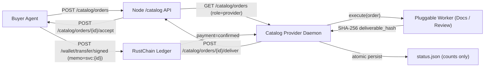

# RustChain Service Catalog Provider Daemon (RIP-302)

Autonomous, unattended service provider agent that lists real work on the RustChain node `/catalog`, watches for orders, delivers artifacts with unique SHA-256 hashes, monitors buyer acceptance and confirmed on-chain payments, and records progress in a crash-resilient state file.

---

## 🏛️ Architecture & Flow



1. **Order Ingestion:** Polls `GET /catalog/orders?role=provider&status=requested` using Beacon signed authentication.
2. **Work Execution:** Executes pluggable worker (`DocsLintWorker` or `CodeReviewWorker`), producing structured markdown deliverables.
3. **Delivery:** Computes SHA-256 `deliverable_hash`, calls `/catalog/orders/<id>/deliver`, and stores state to disk.
4. **Idempotency Across Restarts:** The state manager tracks all processed orders and hashes; restarts will never double-deliver an order.
5. **Settlement Tracking:** Monitors buyer `/accept` and ledger payment confirmation (`svc:<order_id>`), updating `status.json` with counts only (no volume or RTC amounts, complying with the catalog's "work, not volume" rule).

---

## 🚀 Usage

### 1. Requirements
- Python 3.9+ standard library
- `cryptography`
- Registered Beacon identity (`~/.beacon/identity/agent.key` or `--identity`)

### 2. Run the Daemon
```bash
python3 -m scratch.i2_catalog_provider.provider_daemon \
    --node https://rustchain.org \
    --identity ~/.beacon/identity/agent.key \
    --listing-id lst_your_listing_id \
    --category docs \
    --poll-interval 10 \
    --max-concurrent 2 \
    --state-file provider_state.json \
    --status-file status.json
```

### 3. Kill Switch & Safety
- **Kill Switch:** To halt the daemon immediately, touch the kill switch file:
  ```bash
  touch STOP_PROVIDER
  ```
- **Key Safety:** Private keys and passwords are never logged or stored in state.
- **Rate Limiting:** Defaults to 10.0s interval with concurrency capping.

---

## 🧪 Testing

Deterministic mock suite (zero live network dependency):
```bash
pytest scratch/i2_catalog_provider/test_provider_daemon.py -v
```
